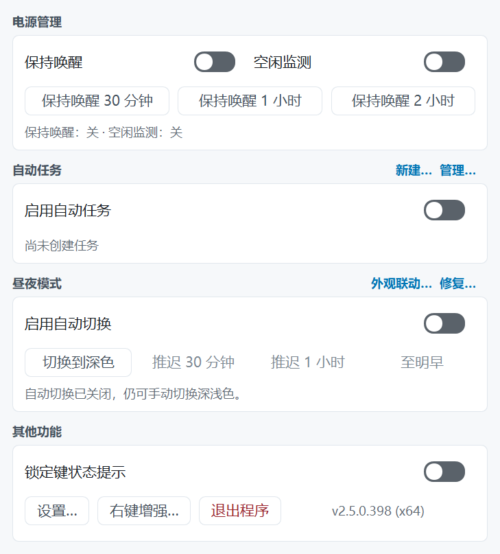
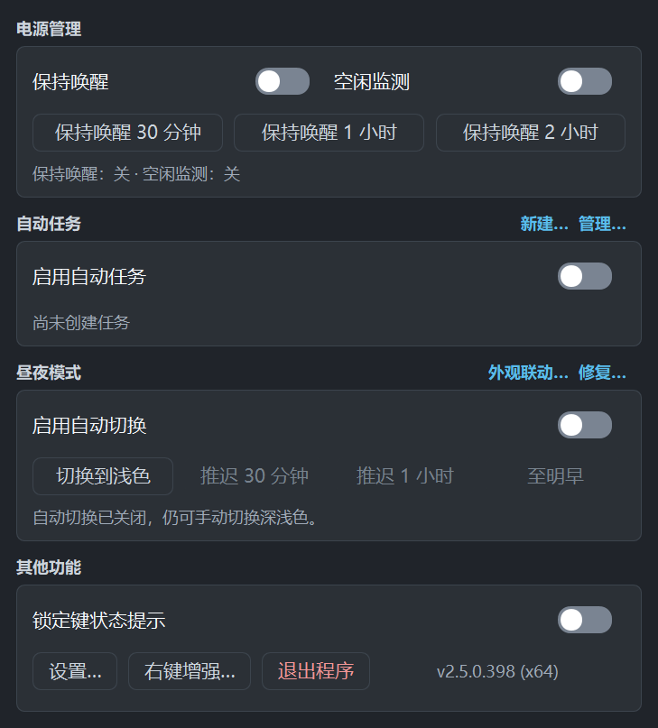
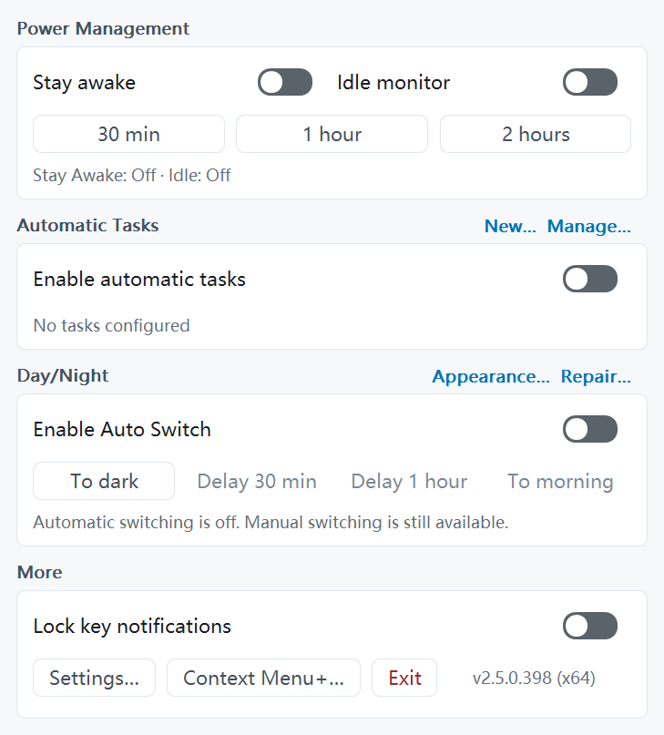
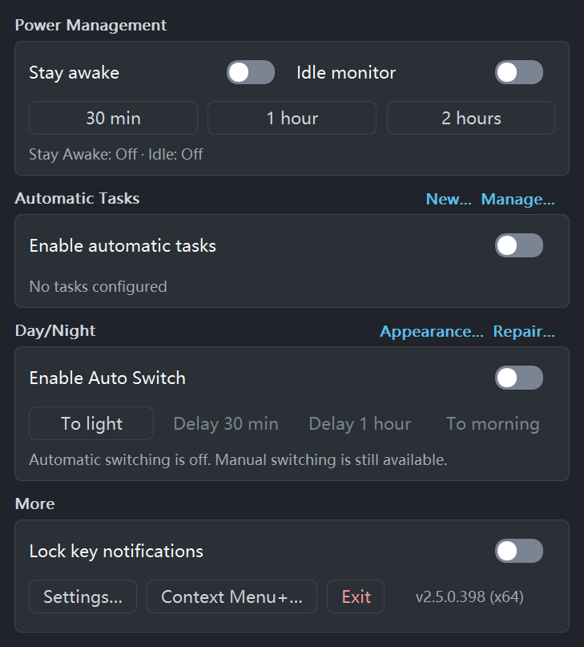
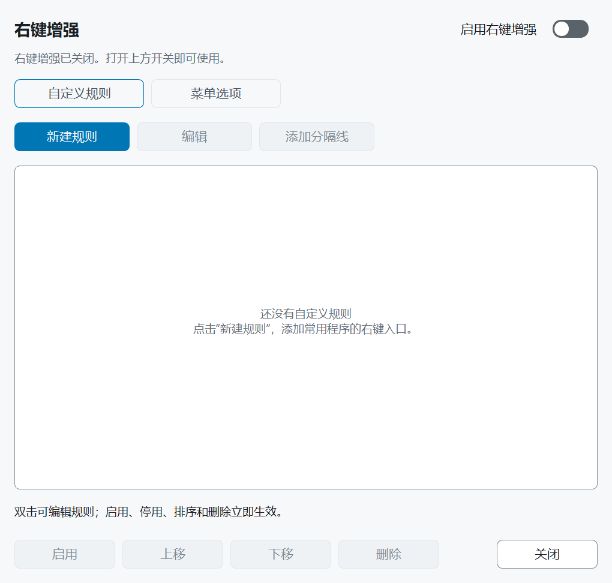
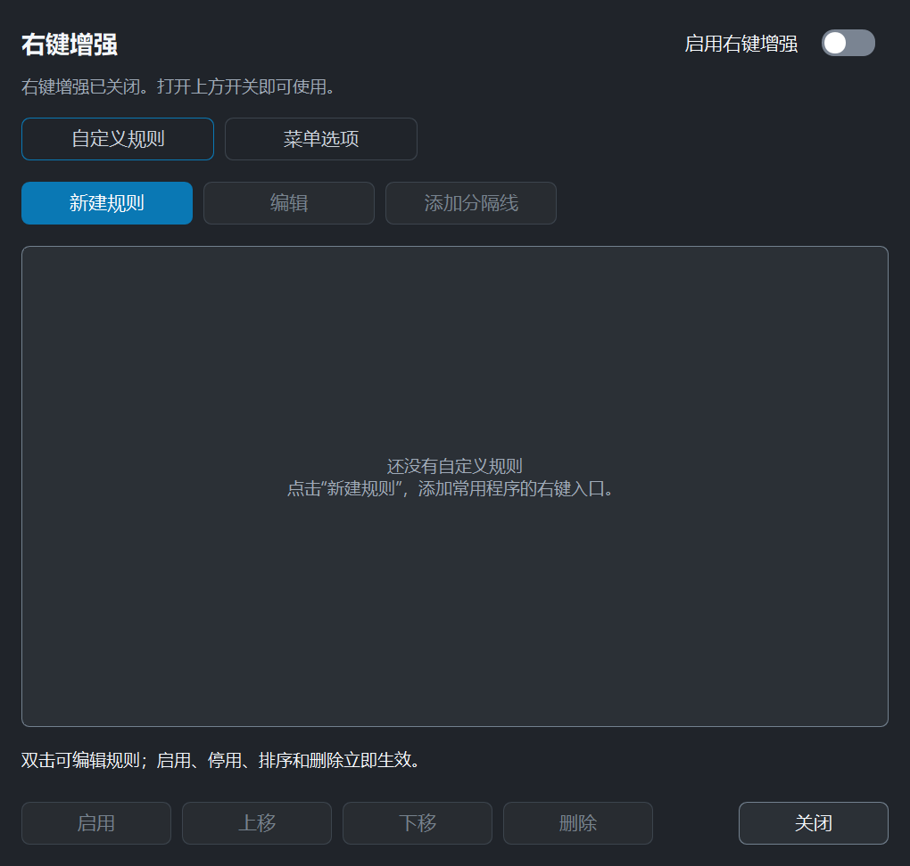
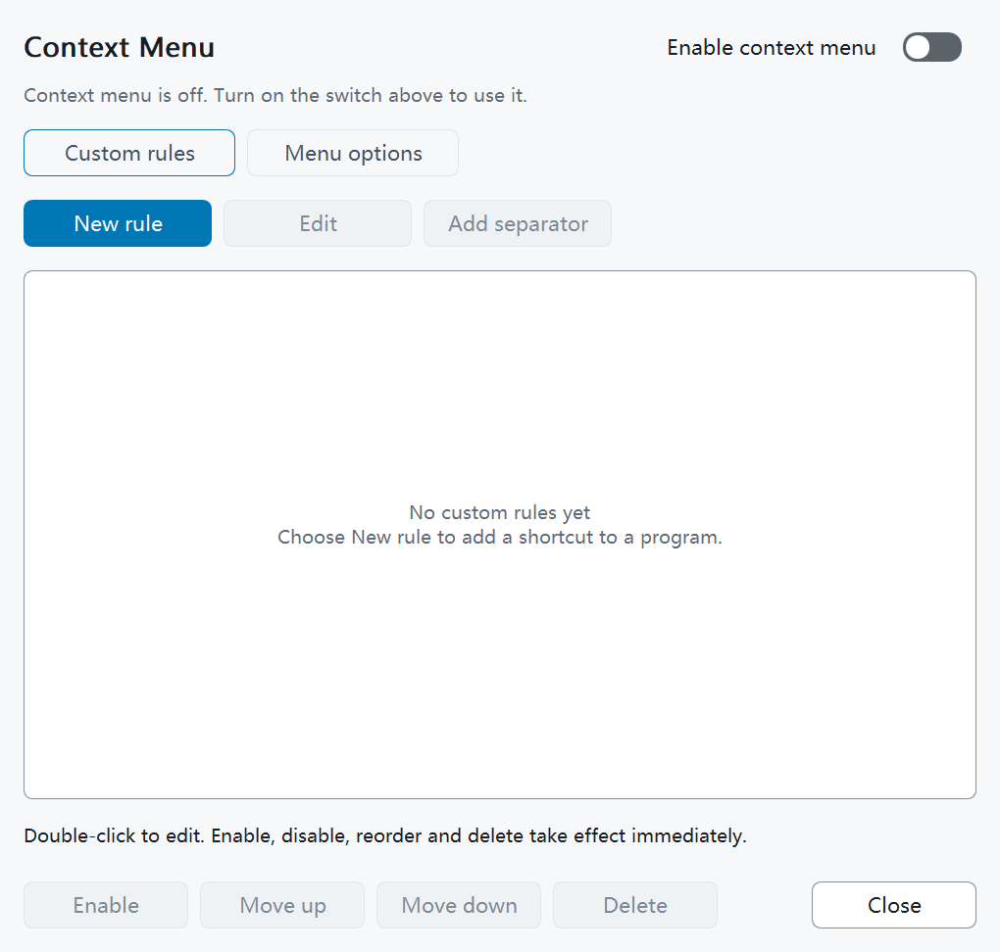
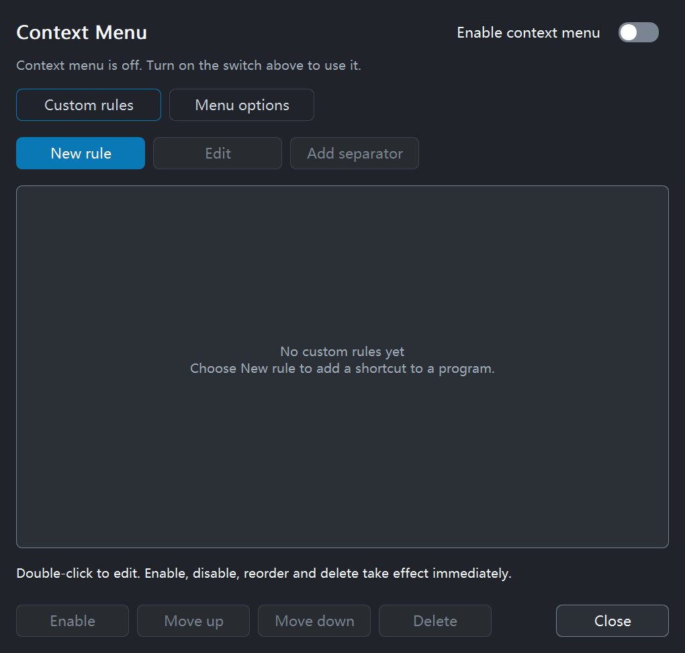

# Screenshots / 界面截图

Captured on 2026-10-11 using the x64 diagnostic build from `80a50a9`; panel images include the subsequent shorter morning-preset labels. These are real application client-area captures with an isolated configuration: automatic features are off and no task or custom rule has been saved. Light/dark overrides affect only the app. Screenshots illustrate the UI, not Explorer execution or a full regression result.

截图于 2026-10-11 基于 `80a50a9` 的 x64 诊断构建生成，面板图片另包含后续的“至明早”按钮短文案修正，均为真实应用客户区。使用独立配置，自动功能关闭，未保存任务或自定义规则；深浅色覆盖仅作用于应用。配图用于展示界面，不代表已验收资源管理器执行效果或完成全量回归。

## Control panel / 控制面板

The panel includes direct task creation, appearance settings, lock-key notifications, and the context-menu manager entry.

面板包含直接新建任务、外观联动、锁定键提示及右键增强入口。

| 简体中文 · 浅色 | 简体中文 · 深色 |
| --- | --- |
|  |  |

| English · Light | English · Dark |
| --- | --- |
|  |  |

## Context-menu manager / 右键增强管理器

Custom rules and menu options share a dedicated window. New rules open an editor; the master switch and menu options apply immediately.

自定义规则与菜单选项整合在独立窗口中。新建规则进入编辑区，总开关及菜单选项即时生效。

| 简体中文 · 浅色 | 简体中文 · 深色 |
| --- | --- |
|  |  |

| English · Light | English · Dark |
| --- | --- |
|  |  |

[User guide / 使用指南](user-guide.md) · [Documentation / 文档索引](README.md)
